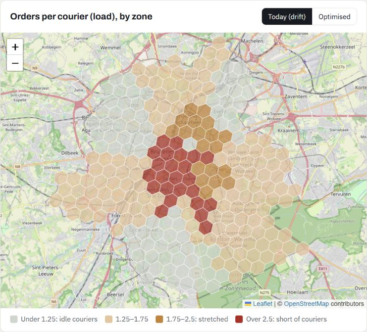
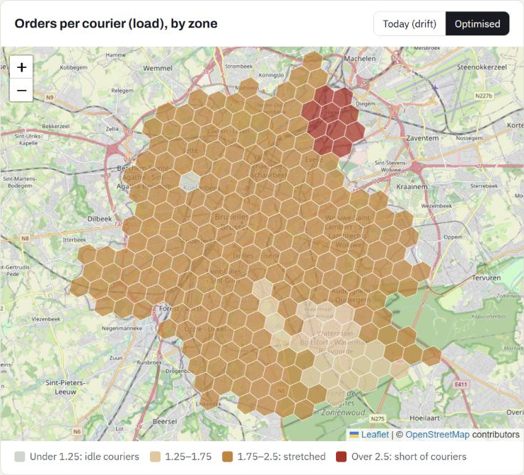

# Winning the Dinner Rush: where couriers should wait in Brussels, and why deliveries run late

**Jessica Ayivi** · Strategy & Operations · [jessicaayivi1@gmail.com](mailto:jessicaayivi1@gmail.com)

Two linked pieces of one case, built for a marketplace operations role:

1. 🗺️ **[Brussels courier-positioning map](https://jessicaayivi.github.io/uber-eats-dinner-rush/optimiser/)**: where couriers are short or idle at each hour, and which moves cut late deliveries with the same fleet. *Real Brussels inputs, simulated orders.*
2. 🔎 **[Dinner Rush analysis](https://jessicaayivi.github.io/uber-eats-dinner-rush/)**: why deliveries miss their promised time, measured on **538,689 real orders** (Meituan), and which levers fix it profitably. *Real orders, not Belgian.*

The analysis is the evidence; the map is the action: the real data shows idle couriers at the peak while busy ones stack 3+ orders, and the map shows where to put them in Brussels.

- 🧮 **Code:** optimiser in [`src/optimiser/`](src/optimiser/), SQL in [`sql/analysis.sql`](sql/analysis.sql), lever model in [`src/sizing.py`](src/sizing.py)
- 📊 **Deck:** [Where Brussels Couriers Should Wait](https://claude.ai/artifact/7fr267bv96b8hgq96Ru1jv) (11 slides, with speaker notes)

---

# Part 1 · Brussels courier-positioning optimiser

**The question:** with the same couriers on duty, where should they wait each hour so that fewer orders arrive late? It answers two lines of the job description directly: *isolate network imbalances* and *tune core marketplace levers*.

> **Real skeleton, simulated orders.** Uber's data isn't public, so I built a Brussels simulation calibrated on real public data. Geography, residents, restaurants, rain hours and the way lateness responds to courier load are real; only the individual orders are simulated, and the weekly volume is an assumption. Nothing here is Uber data.

## Results

| | |
|---|---|
| **Friday 19:00** (769 orders an hour, 163 couriers) | Late orders **128 → 115 an hour (−9.7%)**; −8.6% if 60% of couriers follow the nudge |
| **Couriers moved** | **43 of 163**, mostly **into the Brussels Pentagon (+27)**, Ixelles (+8) and Saint-Gilles (+4), out of Molenbeek (−7), Anderlecht (−5) and Uccle (−4) |
| **Same service, fewer couriers** | Optimally placed, **128 couriers match the service of 163 drifting ones (35 fewer, −21%)** |
| **Rainy Friday 19:00** | Late orders 155 → 141 an hour (−9.1%): rain adds orders without adding couriers |
| **Four simulated weeks** (7 Sep – 4 Oct 2026, real Brussels rain) | ~4,980 → ~4,460 late orders a week (**−10.5%**; −9.2% at 60% compliance) |
| **Across the sensitivity range** | −5.6% to −13.2% a week |
| **The honest caveat** | Spreading couriers in proportion to restaurants gets within **0.8%** of the optimum. The value is not clever maths: it is correcting the drift, every hour, at scale. |

| Friday 19:00, today (couriers drift to where customers live) | Friday 19:00, optimised (same 163 couriers) |
|---|---|
|  |  |

*Hexagons coloured by orders per courier (red = short of couriers, grey = idle). Map data © OpenStreetMap contributors. In the optimised view Haren stays red: its few orders need a single courier, so it reads as overloaded on paper.*

**Why the imbalance exists:** the Pentagon has **29% of Brussels' food places but 5% of its residents**; Molenbeek, Anderlecht and Schaerbeek are the reverse. Couriers finish each trip where customers live, while the next pickups are where the restaurants are.

## Data

| What | Source | Licence | Use |
|---|---|---|---|
| Statistical sectors 2025 (749 in Brussels) and population | [Statbel](https://statbel.fgov.be/en/open-data/statistical-sectors-2025) | CC BY 4.0, "Source: Statbel" (re-apportioned to hexagons) | Residents per hexagon, municipality names |
| Restaurants, fast food, cafés (3,512) | [OpenStreetMap](https://www.openstreetmap.org/copyright) via Overpass | ODbL, © OpenStreetMap contributors | Where pickups happen |
| Hourly weather, Brussels, Sep–Oct 2026 | [Open-Meteo](https://open-meteo.com/) archive | CC BY 4.0 | Real rain hours (37 of 364 service hours in the 4 weeks) |
| Lateness vs courier load, minutes per order, staffing by hour | Meituan orders (Part 2) | CC BY-NC 4.0 | Calibration (aggregated) |
| Demand shape by weekday and hour | DoorDash Kaggle data ([archive](archive/doordash_version/)) | MIT on Kaggle | A Western, dinner-peaked weekly pattern |

`python src/optimiser/download.py` fetches the raw files into `data/raw/brussels/` (not committed).

## Method

1. **Grid** ([`grid.py`](src/optimiser/grid.py)): 252 H3 hexagons (resolution 8, ~0.74 km²), residents spread from statistical sectors by area overlap, food places counted per hexagon, grouped into **25 dispatch zones**: the 19 municipalities, with the City of Brussels split into its 7 Statbel sub-areas.
2. **Behaviour** ([`calibrate.py`](src/optimiser/calibrate.py)): load = orders × 25 minutes with a courier ÷ 60 ÷ couriers (Little's law). On the real Meituan data, late rate = 10.6% + 6.5 pts × ln(load): **each doubling of the load adds 4.5 points of late deliveries** (floor 10.7%).
3. **Demand** ([`demand.py`](src/optimiser/demand.py)): orders per zone and hour = weekly volume × weekday/hour shape × pickup share (70% food places, 30% residents) × +15% in rain hours. Couriers on duty follow the real network's staffing by hour. Four weeks simulated (Poisson, seed 42).
4. **Optimiser** ([`model.py`](src/optimiser/model.py), [`optimise.py`](src/optimiser/optimise.py)): give each next courier to the zone where it removes the most late orders. Because the curve is convex in couriers, this greedy rule is exactly optimal; an integer program (PuLP / CBC) returns **the identical allocation** on three test hours. Baseline: couriers drift to where drop-offs end (in proportion to residents).
5. **Map** ([`optimiser/index.html`](optimiser/index.html)): Leaflet on OpenStreetMap tiles; the optimiser runs live in the browser and [`check_page.py`](src/optimiser/check_page.py) confirms it matches the Python results exactly.

## Assumptions and sensitivity

| Input | Value | Source |
|---|---|---|
| Late-rate curve | 10.6% + 6.5 pts × ln(load), floor 10.7% | Data (Meituan) |
| Minutes an order spends with a courier | 25 | Data (Meituan) |
| Couriers on duty by hour | load 1.1–2.5, as in the real network | Data (Meituan) |
| Demand by weekday and hour | weekly shape | Data (DoorDash) |
| Rain hours | ≥ 0.2 mm in an hour | Data (Open-Meteo) |
| Orders a week | 30,000 | Assumption |
| Pickup share of a zone | 70% food places + 30% residents | Assumption |
| Rain uplift | +15% orders, same couriers | Assumption |
| Couriers following a nudge | 60% | Assumption |
| Minimum per zone | 1 courier | Assumption |

Each input at 70% and 130% ([`data/optimiser/sensitivity.csv`](data/optimiser/sensitivity.csv)): realised weekly reduction · Friday 19:00 at full compliance · couriers saved at equal service.

| Input (default) | At 70% | At 130% |
|---|---|---|
| Orders a week (30,000) | 9.7% · −9.2% · 23 fewer | 8.9% · −9.3% · 44 fewer |
| Pickup weight on food places (0.7) | 5.6% · −5.5% · 20 fewer | 13.2% · −15.0% · 54 fewer |
| Rain uplift (+15%) | 9.2% · −9.7% · 35 fewer | 9.2% · −9.7% · 35 fewer |
| Couriers following nudges (60%) | 7.7% · −9.7% · 35 fewer | 10.1% · −9.7% · 35 fewer |
| Couriers on duty (100%) | 8.2% · −7.9% · 22 fewer | 10.7% · −11.8% · 50 fewer |
| Curve slope (+4.5 pts per doubling) | 7.3% · −7.7% · 35 fewer | 10.8% · −11.4% · 35 fewer |
| Minutes per order (25) | 9.7% · −9.2% · 23 fewer | 9.0% · −9.3% · 44 fewer |

**What holds:** positioning always helps, by 5–13% a week. **What drives it:** how concentrated pickups really are; that is the first number to measure on real Uber data (pickup locations by hour).

**Limitations:** zones are treated as independent (in reality couriers near a border serve both sides, which shrinks the imbalance); couriers move instantly within the hour; one weekly demand shape for all zones; the curve comes from another country's network.

---

# Part 2 · The evidence: why deliveries run late (real Meituan data)

Why do food deliveries miss the time promised to the customer, and which marketplace levers fix it profitably? I analysed **538,689 real orders from Meituan**, each with its promised delivery time and every dispatch step, and this is how I would apply the method at Uber Eats Belgium.

- 🎛️ **Interactive simulator:** [jessicaayivi.github.io/uber-eats-dinner-rush](https://jessicaayivi.github.io/uber-eats-dinner-rush/)
- 🧮 **Analysis:** SQL in [`sql/analysis.sql`](sql/analysis.sql), lever model in [`src/sizing.py`](src/sizing.py), every assumption in [`src/assumptions.py`](src/assumptions.py)

> **About the data.** Meituan's public research dataset (INFORMS TSL Research Challenge): one Chinese city, 23 business districts, Monday 17 – Monday 24 October 2022, with anonymised IDs and shifted coordinates. **It is not Uber data and not Belgian data.** It has no prices, fees, pay or weather, so every euro figure here is a labelled assumption. Licence CC BY-NC 4.0; raw data is not redistributed. *This research was supported by data provided by Meituan.*

## Key findings

| | |
|---|---|
| **The SLA is broken on 1 order in 7** | 14.6% of orders arrive after the promised time (4.6% by more than 5 minutes). Promises average 35 minutes; deliveries take a median 28. |
| **Most misses are near-misses** | **Two-thirds of late orders miss by 5 minutes or less**, nearly half by 3 minutes or less. Small, targeted time savings convert a lot of late orders. |
| **It breaks at the peaks** | Lunch (11:00, 17.6% late) and above all dinner (17:00–18:00, 19%). Friday 17:00–18:00 reaches 21–22%. The worst 10% of district-half-hours hold 61% of late orders. |
| **Root cause: the last mile and the pickup** | For each late order I compared every stage with on-time orders in the same district, hour and distance. The biggest overrun is the **last mile in 55%** of late orders, the **restaurant pickup in 34%**, waiting for dispatch in 7%, courier refusals in 3%. |
| **Stacking orders is what makes the last mile late** | Like for like (same district and hour), a 2nd order in a courier's run adds 5 points of lateness and a 3rd adds 10 (+2.2 and +3.7 minutes of last mile). Beyond 3 it barely gets worse. |
| **…while couriers sit idle** | At every lunch-peak dispatch snapshot (11:25–11:30, all 8 days), **30% of the ~2,600 candidate couriers carry no order**, against ~660 orders waiting. The peak is a matching problem more than a headcount problem. |
| **A few restaurants drive pickup delays** | The slowest 10% of merchants (by pickup overrun) take 7.5% of orders but 10% of late ones: 19% late vs 14%, and pickups take 4.4 minutes longer. |
| **Refusals are expensive** | 10% of orders are refused by a courier at least once; they are late 23% of the time vs 13.5%. Districts where refusals are common (12–19% of orders) run 16–20% late; districts with almost none run 3–16% (a correlation, worth a test). |
| **Under load, promises stretch before they break** | Lateness climbs from 11% to 16% as couriers go from ~1.25 to 2 orders each, then flattens: beyond ~2 the platform absorbs load by promising later (36 → 42 minutes). |

## Recommendation

1. **Merchant fixes (account management):** give account managers the ranked list of the slowest merchants; fixing half their pickup overrun avoids **~3,100 late deliveries a week**, at no platform cost.
2. **Fewer refusals (dispatch / product):** better matching and acceptance nudges; removing 30% of refusal delay avoids **~520 a week**.
3. **Stacking cap, targeted:** don't make an at-risk order the 3rd+ in a run when an idle courier is nearby. Avoids **~5,100 a week**, but each avoided late delivery costs **~€34** in extra trips.
4. **Targeted quests** where couriers carry more than 2.5 orders each: **~1,600 a week at ~€13** per late delivery avoided.

**Impact:** late deliveries 14.8% → 12.6% (standard-week basis), ~10,400 fewer a week (−15%).

**Compared with a blanket bonus** for every courier at lunch and dinner peaks: ~2,000 late deliveries avoided for ~€249k a week, **~€124 each**. Targeted levers beat it in all 26 sensitivity cases.

**The honest caveat:** at my default value of a late delivery (half a lost future order × €27 × 19% ≈ €2.57), only the free levers pay (~+€9,300 a week). Quests pay only if a late delivery costs ~2.5 lost orders; the stacking cap only at ~6.6. So: **roll out 1–2 now, test 3–4 in a switchback experiment** (district × 2-hour blocks), and measure first what a late delivery really costs in retention and refunds. A second test worth running: a 2–3 minute promise buffer on at-risk orders, given that most misses are near-misses (its conversion cost cannot be measured in this data).

## What changed from earlier versions

This case started on simulated Belgian data, then moved to DoorDash + Indian Kaggle data (both in [`archive/`](archive/)). Each step made it more real:

| | Simulated | DoorDash (2015) | Meituan (2022, now) |
|---|---|---|---|
| Defect | Unfulfilled orders (invented) | Delivered > 60 min (threshold I chose) | **Delivered after the promised time** (the real SLA) |
| Late rate | 5.1% unfulfilled | 19.5% | **14.6%** |
| Root cause | Not measurable | Partly (load only) | **Per order, per stage** |
| Batching | Assumed | Borrowed from Indian data | **Measured like for like** |
| Main lever | Rebalance + quests | Rebalance + batching + quests | **Merchants, refusals, stacking**; quests second |
| Blanket bonus | €35 per saved order | $40 per late avoided | **€124 per late avoided** |
| Impact | −57% | −10% | **−15%** |

## Data

| | |
|---|---|
| Source | [Meituan-INFORMS-TSL-Research-Challenge](https://github.com/meituan/Meituan-INFORMS-TSL-Research-Challenge) (Meituan, INFORMS Transportation Science & Logistics) |
| Content | 654,343 waybills (an order gets a new waybill each time a courier refuses it), courier runs ("waves"), and 24 dispatch snapshots with candidate couriers |
| Per order | created, sent to dispatch, offered, accepted, picked up, delivered; **promised delivery time**; estimated food-ready time; district, merchant, courier; pickup and drop-off coordinates (shifted) |
| Licence | CC BY-NC 4.0, redistribution not allowed: raw files stay out of Git (`bash src/download_data.sh` fetches them); only aggregated tables are committed and embedded in the simulator |
| Missing | Prices, fees, courier pay, weather, app sessions (so no conversion or dynamic-fee analysis) |

**Cleaning** ([`data/meituan_cleaning.json`](data/meituan_cleaning.json)): 568,546 accepted orders → removed 1 never delivered, 22,181 pre-booked (different promise logic), 7,444 without a food-ready estimate, 212 with timestamps out of order, 19 over 180 minutes → **538,689 orders**. Timestamps are UTC+8 (peaks land at 11:00 and 17:00–18:00). Weekly figures count each weekday once; Monday appears twice in the 8 days, which is why the model's late rate (14.8%) differs slightly from the raw 8-day average (14.6%).

## Assumptions

Everything the model uses that is not measured, in one place: [`src/assumptions.py`](src/assumptions.py).

| Input | Value | Source |
|---|---|---|
| Late | delivered after the promised time | Data |
| Slow merchants targeted | slowest 10% (50+ orders) by pickup overrun | Data |
| Stacking cap | 2 orders per run | Data: the 3rd order adds ~5 late points over the 2nd |
| Net revenue per order | 19% of bookings | Public: Uber Q3 2026, Delivery revenue $5.5B ÷ gross bookings $28.5B |
| Merchant overrun removed | 50% | Assumption |
| Refusal delay removed | 30% | Assumption |
| At-risk orders re-routed | 50% | Assumption |
| Re-routed orders really at risk | 25% | Assumption |
| Extra pay per separate trip | €2.50 | Assumption |
| Gap filled by quests | 35% | Assumption |
| Quest trigger | load above 2.5 orders per busy courier | Assumption |
| Quest pay | €5 per extra hour, 30% leakage | Assumption |
| Blanket bonus | €4 per busy courier-hour, 11:00–13:00 and 17:00–20:00, 60% of gap shows up | Assumption |
| Average basket | €27 | Assumption (no prices in the data) |
| Future orders lost per late delivery | 0.5 | Assumption |

## Sensitivity

Each assumption at 50% and 150% of its default, everything else unchanged ([`data/results/sensitivity.csv`](data/results/sensitivity.csv)). Default: 12.6% late after the levers, −€169k a week, and €34 / €12.9 / €124 spent per late delivery avoided by the stacking cap / quests / blanket bonus.

| Assumption (default) | At 50%: late after · net/week · € per late (stacking / quests / blanket) | At 150% |
|---|---|---|
| Merchant overrun removed (0.5) | 12.89% · −€172k · €34 / €12.5 / €124 | 12.44% · −€167k · €34 / €12.9 / €124 |
| Refusal delay removed (0.3) | 12.68% · −€170k · €34 / €13.1 / €124 | 12.50% · −€168k · €34 / €12.8 / €124 |
| At-risk orders re-routed (0.5) | 13.12% · −€88k · €34 / €12.5 / €124 | 12.06% · −€250k · €34 / €13.3 / €124 |
| Re-routed orders really at risk (0.25) | 12.59% · −€344k · €68 / €12.9 / €124 | 12.59% · −€111k · €23 / €12.9 / €124 |
| Extra pay per separate trip (€2.50) | 12.59% · −€81k · €17 / €12.9 / €124 | 12.59% · −€256k · €51 / €12.9 / €124 |
| Gap filled by quests (0.35) | 12.78% · −€161k · €34 / €14.9 / €124 | 12.44% · −€177k · €34 / €13.3 / €124 |
| Quest trigger (2.5) | 12.59% · −€174k · €34 / €16.4 / €124 | 12.76% · −€157k · €34 / €7.8 / €124 |
| Quest pay (€5) | 12.59% · −€159k · €34 / €6.5 / €124 | 12.59% · −€179k · €34 / €19.4 / €124 |
| Quest leakage (0.3) | 12.59% · −€166k · €34 / €11.4 / €124 | 12.59% · −€171k · €34 / €14.4 / €124 |
| Blanket bonus (€4) | unchanged · blanket €62 | unchanged · blanket €185 |
| Gap filled by blanket bonus (0.6) | unchanged · blanket €214 | unchanged · blanket €124 |
| Average basket (€27) | 12.59% · −€182k | 12.59% · −€156k |
| Future orders lost per late delivery (0.5) | 12.59% · −€182k | 12.59% · −€156k |

**What holds:** the free levers always pay, and targeted quests beat the blanket bonus in all 26 cases (at worst €19 vs at best €62 per late delivery avoided). **What doesn't:** the paid levers only pay if a late delivery is worth far more than my default; that is the number to measure first.

## Repository (both parts)

```
src/download_data.sh          fetches the Meituan dataset into data/raw/meituan/ (not committed)
src/prepare_meituan.py        cleaning, stage times, root causes, slow merchants, stacking cost -> data/meituan.db + aggregated CSVs
sql/analysis.sql              10 questions: scorecard, hours, root causes, stages, concentration, batching, merchants, refusals, load, idle couriers
src/run_sql.py                runs every query, saves data/results/<query>.csv
src/assumptions.py            every non-measured input, with its source
src/sizing.py                 load curves, levers, blanket comparison, sensitivity -> data/sizing.json
src/build_simulator.py        injects the aggregated tables and curves into simulator/template.html
src/check_simulator.py        runs the simulator's JS model and checks it reproduces sizing.py (also in CI)
src/run_all.sh                the whole pipeline
simulator/index.html          built simulator, published by .github/workflows/pages.yml
archive/                      the simulated and the DoorDash versions (not used)

src/optimiser/download.py     Statbel, OpenStreetMap and Open-Meteo inputs -> data/raw/brussels/ (not committed)
src/optimiser/calibrate.py    response curve, minutes per order, staffing, demand shape -> data/optimiser/calibration.json
src/optimiser/grid.py         H3 hexagons, residents, food places, 25 zones
src/optimiser/demand.py       simulated orders with real rain hours
src/optimiser/model.py        lateness, greedy optimiser, baselines, moves
src/optimiser/optimise.py     scenarios, PuLP cross-check, 4-week totals, sensitivity -> data/optimiser/results.json
src/optimiser/build_page.py   builds optimiser/index.html
src/optimiser/check_page.py   checks the map's JS optimiser against optimise.py (also in CI)
optimiser/index.html          the map, published at /optimiser/
```

## Reproduce

```bash
pip install -r requirements.txt
bash src/run_all.sh      # rebuilds both parts and runs both checks
```

## Limitations

One city, 8 days, autumn 2022, in a market with different courier economics from Belgium. The root-cause split compares each order with typical on-time orders, so it is an attribution, not an experiment. Courier supply is only visible while couriers carry orders (except at the 24 lunch snapshots). No weather, prices or conversion data. Every euro figure is an assumption. Each of these is a reason to rerun the queries on Uber's own Belgian data before acting.
